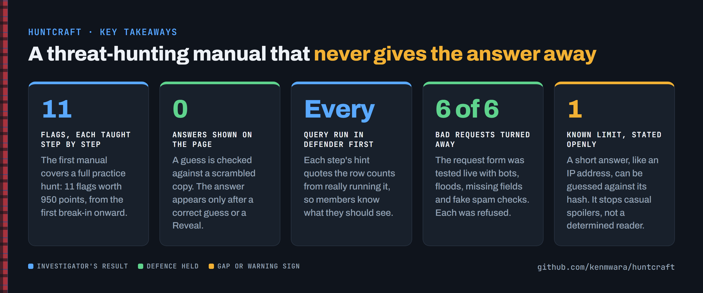
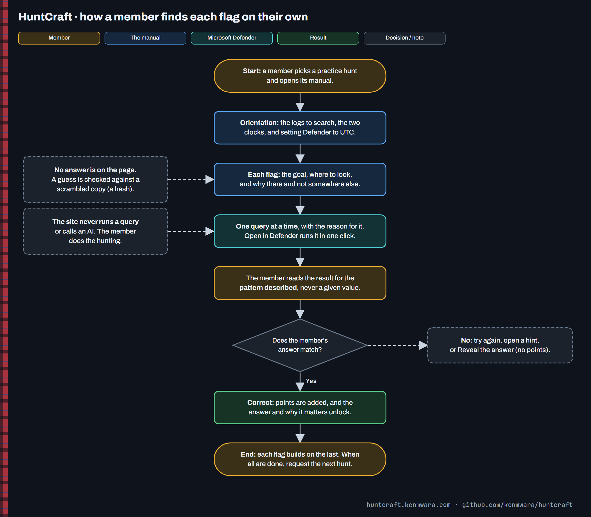
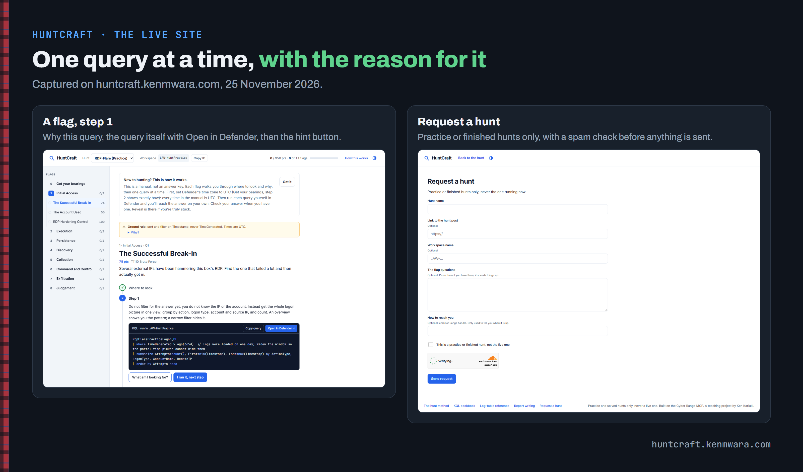

# HuntCraft

A step-by-step threat-hunting instruction manual for Cyber Range members, live at
**https://huntcraft.kenmwara.com**.

Hunt content by SancLogic / the Cyber Range threat hunt team. Manuals by Ken Kariuki. Built on the Cyber Range MCP. Independent, not affiliated.

HuntCraft teaches the method, not the answers. For each flag of a practice hunt it explains where to look and why,
gives one query at a time with the reasoning behind it, and describes the pattern to look for. Members run every
query in their own Microsoft Defender and find the flag themselves. Answers stay hidden until a correct guess or a
deliberate Reveal.

## At a glance

## The site

## Key design decisions

| Decision | Why |
|---|---|
| A manual, never an answer key | Members asked where to start, not for answers. Answer keys also break community hunt rules. |
| Members hunt in Microsoft Defender | The skill being taught is reading real telemetry. The site never runs a query or calls an AI, so a visit costs nothing to serve. |
| No answer in the page | A guess is compared against a salted hash. The answer and its explanation load only after a correct guess or a Reveal. |
| Practice and retired hunts only | The live hunt is refused by the generator, the review page and the build. Each published hunt carries a dated clearance record. |
| Real results only | Every query was run in Defender before publishing, and each hint quotes the real row counts. |

## How it is built

- **Writing a manual (offline).** `tools/generate.py` drafts a manual with Claude, limited to the Cyber Range MCP's
  read-only log-search tools. `tools/review.py` is a local review page: every query is re-run, every field is checked
  for a leaked answer, and a person marks each flag reviewed before it can publish.
- **The member site.** `build.py` turns each hunt's `guide.json` into a static page on Cloudflare Pages. It refuses a
  live hunt, a hunt without a clearance record, a page carrying an email address, and a page missing its icon or
  share tags.
- **Request a hunt.** `worker/request` is a Cloudflare Worker behind the same domain. It checks the method, origin,
  size and every field, rejects a hidden trap field, allows 5 requests an hour per visitor (keyed on a salted hash,
  never the address), verifies Cloudflare Turnstile, stores the request in D1 and sends one email.

## Results

- **First manual published:** RDP-Flare (Practice), 11 flags, 950 points, with an orientation step that sets
  Defender to UTC and explains the two clocks in the lab data.
- **Request form, tested live:** a wrong method, a missing field, the trap field, an extra field, a fake spam check and
  a sixth request inside an hour were each refused (405, 400, 400, 400, 400, 429). A valid request stored one row and
  sent one email.
- **Generator benchmark:** on RDP-Flare it answered 9 of 11 flags correctly and its leak check caught 2 drafts that
  gave an answer away. Every manual is still reviewed by a person before publishing.

## Known limits

- The reveal files (`site/reveals/`) are public by design, the same as clicking Reveal. A short answer such as an IP
  address can be guessed against its hash; the hashing stops casual spoilers, not a determined reader.
- A later flag's query may contain an earlier flag's answer when the hunt pivots on it. The member has already found
  it by then.
- The solve trail and reports that produced each manual are kept in a separate private repository.

## Scope

| Hunt | Status | Flags |
|---|---|---|
| RDP-Flare (Practice) | Published 25 Nov 2026 | 11 |

Members can request the next hunt at https://huntcraft.kenmwara.com/request.

Repository layout and commands

| | |
|---|---|
| Design | [`docs/SolutionDesign.md`](docs/SolutionDesign.md) |
| Plan | [`docs/PhasedSolutionPlan.md`](docs/PhasedSolutionPlan.md) |
| Hunts | `hunts/<slug>/guide.json`, `hunts/registry.json` |
| Knowledge base | `knowledge/*.md` (the hunt method, KQL cookbook, log-table reference, report writing) |
| Build the site | `python build.py` |
| Deploy | `npx wrangler pages deploy site --project-name huntcraft --branch main` |
| Deploy the request Worker | `cd worker/request && npx wrangler deploy` |
| Generate a draft | `python tools/generate.py <slug> --questions hunts/<slug>/questions.md` |
| Review and publish | `python tools/review.py`, then open http://127.0.0.1:8770 |
| Checks | `python tools/generate.py --selftest` and `python tools/review.py --selftest` |

Diagram source: `images/flow.drawio`.

## Credits

Hunt content by SancLogic / the Cyber Range threat hunt team. Manuals by Ken Kariuki. Built on the Cyber Range MCP. Independent, not affiliated.

The Inter typeface (used for the site and its images, bundled at `tools/fonts/Inter.ttf`) is licensed under the SIL Open Font License 1.1 (`tools/fonts/OFL.txt`).
