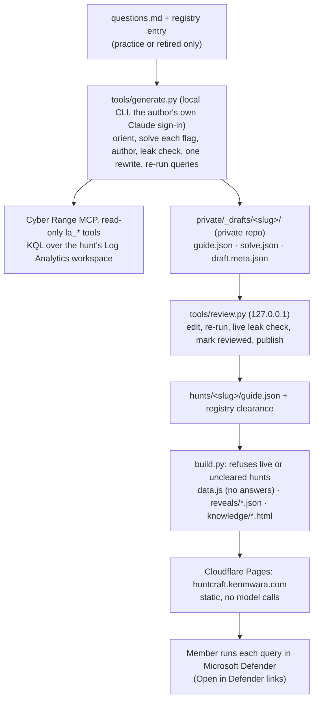

# HuntCraft: Solution Design

**Created:** 25 Nov 2026 · **Method:** Cairn · **Status:** live at https://huntcraft.kenmwara.com

## 1. Problem
Cyber Range members keep posting "Need help" threads: where do I start a threat hunt, and what exactly do I do?
Answer keys don't help them (and break community hunt policy). What helps is seeing the method: which table, why that
query and not another, what pattern to look for, and how the flag falls out of the result.

## 2. What HuntCraft is
An **instruction manual, never an answer key**. For each flag of a practice or solved hunt it gives the objective,
where to look and why there (and why not elsewhere), one query at a time with the reasoning for choosing it, and what
to look for (the pattern, never the value). The member runs every query in Microsoft Defender themselves and finds
the flag on their own. The answer stays hidden: a hashed Check, a Reveal, or multiple choice.

## 3. Architecture

| Piece | Where | Notes |
|---|---|---|
| Member site | `site/index.html`, `site/data.js` | Static. Answers are not in `data.js`: Check compares `sha256(salt + norm(answer))`, the answer and why are fetched from `site/reveals/<slug>/f<N>.json` only on Reveal or a correct Check. |
| Knowledge base | `knowledge/*.md` → `site/knowledge/*.html` | The hunt method, KQL cookbook (two clocks), log-table reference (Range `_CL` tables), report writing. |
| Generator | `tools/generate.py` | `claude -p`, limited to the four read-only `la_*` tools (any other tool aborts the run). Uses the claude.ai Range connector with deferred tool loading (the Range accepts no other sign-in yet). |
| Review page | `tools/review.py` + `tools/review.html` | Local only, POSTs need a per-run token. Publish needs every flag reviewed, three checks, a clearance name and a clean leak check. |
| Gate | `hunts/registry.json` + `build.py` | Live hunt = refused everywhere. No `clearance` record = not built. |

## 4. Rules that hold everywhere
- **Practice or retired hunts only.** The live hunt is refused by the generator, the review page and the build.
- **Members hunt in Defender.** Every query carries `| where TimeGenerated > ago(365d)` as line 2 (the lab loads
  all logs on one day; Defender's 7-day picker would hide them). The site shows how to set Defender to UTC and why.
- **Two clocks.** `TimeGenerated` is the load time; `Timestamp` is the real event time. Hunt on `Timestamp`.
- **No one spends Ken's tokens.** The member site makes no model calls. A member who generates a draft uses their
  own Claude account and their own Range sign-in.
- **Real results only.** Every `look_for` quotes row counts from actually running the query in Defender.

## 5. Known limits (stated, not hidden)
- The reveal files are public URLs, and a short answer (an IP, a file name) can be brute-forced against its hash.
  Multiple-choice hashes can be checked against the four public choices in one line. The hashing stops casual
  spoilers in dev tools, not a determined reader.
- An earlier flag's answer appears in a later flag's query when the manual pivots on it. That is by design: the
  member has already found it.
- The full solution trail (`solve.json`, `report.md`, answer files) lives in the private `huntcraft-solutions`
  repo, never in the public one.

## 6. Risks
| Risk | Mitigation |
|---|---|
| Publishing a still-playable hunt's solution | Registry `clearance` record (date and scope) required by `build.py`; RDP-Flare cleared on 25 Nov |
| Generated text leaks the answer | Deterministic leak check over every field and accept spelling, a model pass, one rewrite, then human review by field |
| A manual drifts from the real telemetry | The generator and the review page re-run every query; look_fors quote real counts |
| Looks like live-hunt automation | Practice-only scope enforced in code and stated on the site |
